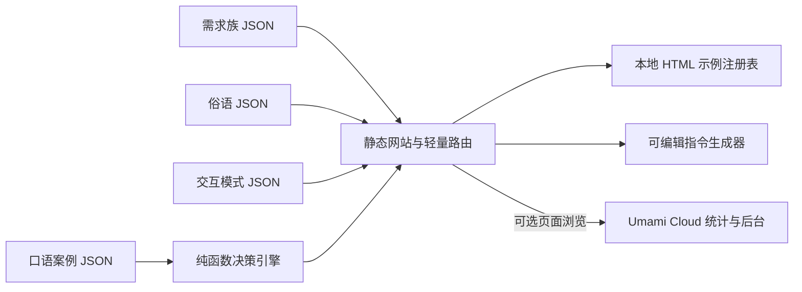

# 当前架构基线：说准一点

- 状态：静态站点 + 可选托管分析 v0.4
- 目标：从新手口语场景出发，通过条件分支展示多个合适的交互模式，允许读者操作示例并复制更准确的 AI 指令。
- 产品设计：[`docs/system-design.md`](../docs/system-design.md)
- 任务记录：[`Task Constitution.md`](../Task%20Constitution.md)

## 设计约束

- 主要用户是不熟悉 UI 术语的新手产品经理和 AI Coding 新手。
- 内容以用户目标与场景组织；一个案例可以引用多个模式，一个模式可以被多个案例引用。
- 条件缺失时应展示并列可能性；只有答案满足分支条件时才给出确定推荐。
- 内容维护者主要改 JSON 文案和受限引用，不需要写决策代码。
- 项目没有自有账号、应用后端、数据库或模型 API；搜索和需求回答留在浏览器中。可选的 Umami Cloud 页面访问统计由第三方托管。
- 发布形态是普通静态文件：HTML、CSS、原生 JavaScript 与 JSON；不引入 UI 框架、构建流水线或服务端运行逻辑。
- 目前交互示例是仓库中的本地代码，内容 JSON 只能指定已登记的 `demoId`。

## 模块边界

| 模块 | 当前位置 | 责任 | 依赖边界 |
|---|---|---|---|
| 需求族 | `src/data/families.json` | 从“用户想做什么”划分主入口 | 只引用稳定的 `family.id` |
| 案例内容 | `src/data/cases.json` | 保存新手说法、目标、场景、澄清问题和带理由的推荐分支 | 推荐引用模式 ID，不承载页面或可执行代码 |
| 俗语映射 | `src/data/colloquialisms.json` | 保存新手日常表达、常见变体、区分问题，以及一个表达可能对应的多个模式和案例 | 通过 `patternIds`、`caseIds` 关联稳定 ID；不承载 HTML 或可执行内容 |
| 模式内容 | `src/data/patterns.json` | 保存中文优先的显示名称、专业标准名、解释、适用边界、差异和指令示例 | 通过 `family`、`demoId` 与其他数据关联 |
| 决策引擎 | `src/lib/decision-engine.js` | 以纯函数按答案筛选匹配分支 | 不读 DOM，不修改数据，也不调用网络 |
| 示例注册表 | `src/lib/demo-catalog.js` | 将已知模式 ID 映射为原生 HTML 交互预览 | 只运行仓库内的受控示例；数据不能注入脚本 |
| 指令生成器 | `src/lib/prompt-builder.js` | 组合目标、场景、推荐理由、模式和行为要求 | 不依赖模型服务；返回普通文本 |
| 网站壳与路由 | `index.html`、`src/app.js`、`src/styles.css` | 五入口导航、搜索、俗语索引和详情、场景详情、术语索引、内容帮助页、渲染和交互事件 | 调用数据与纯函数模块，不重复实现分支规则 |
| 访问统计适配器 | `src/lib/analytics.js`、`src/lib/analytics-config.js` | 配置有效且域名匹配后加载 Umami Cloud tracker；未配置时不发起请求 | 只接入页面浏览，不发送搜索/提示词/控件输入；尊重 DNT，排除查询参数 |
| 统计服务与后台 | Umami Cloud | 接收页面浏览事件，为维护者提供访问分析后台 | 由项目维护者创建账户和站点；数据处理按 Umami Cloud 当时适用条款 |

## 页面访问统计契约 C-001

- 状态：已冻结
- 生产者：主站 `src/lib/analytics.js` 加载的 Umami tracker。
- 消费者：由网站所有者控制的 Umami Cloud 项目和后台。
- 输入：标准页面浏览；hash 路由用于区分内容页；当前 URL 查询参数不采集；浏览器 DNT 开启时不统计。
- 输出：Umami 后台可见页面浏览、会话、来源、浏览器、设备和大致地区。
- 隐私边界：不发送站内输入框内容、AI 指令、示例数据或自定义点击事件。Umami 以 IP 和浏览器信息计算匿名会话及地区；原始 IP 不作为标准分析记录字段，但第三方处理可能涉及运行/安全日志。
- 兼容性：网站 ID 为空时关闭；允许域名以 `analytics-config.js` 为准；不改变无统计时的页面功能。
- 验证：部署后在 Umami Realtime 面板核对首次加载及 hash 路由；需维护者配置网站 ID 后执行。

## 内容契约

### 案例

`cases.json` 每个对象包含稳定 `id`、所属 `family`、新手 `phrase`、`goal`、`context`、可搜索 `keywords`、`questions` 和 `recommendations`。

- 问题使用 `{ id, prompt, options: [{ id, label, hint? }] }`。
- 推荐分支使用 `{ when, primaryPatternId, supportingPatternIds, alternativePatternIds, reason }`。
- `when` 是问题 ID 到选项 ID 的简单映射，例如 `{ "count": "few" }`。当前决策器以精确匹配所有条件的方式判断分支。
- 若当前答案没有匹配规则，决策器返回该案例的所有推荐分支，让 UI 展示并列可能性。

### 交互模式

每个 `patterns.json` 对象至少包含 `id`、标准名 `term`、易懂的中文显示名 `localName`、`family`、`aliases`、`summary`、`useWhen`、`avoidWhen`、`contrast`、`demoId` 和 `promptExample`。默认页面和生成指令优先使用 `localName`，专业名放在辅助位置。同一模式 ID 可从多个 Case 和 Colloquial Phrase 引用。

`colloquialisms.json` 对象使用稳定 `id`、`phrase`、`aliases`、`description`、`question`、`patternIds` 和 `caseIds`。一个俗语可关联多个模式；一个模式也可从多个俗语入口进入。俗语入口负责解释这些说法没有错，只是范围较宽，并用一个新手容易回答的问题帮助比较。

俗语详情按“效果名称 → 可操作 HTML 预览 → 按需展开效果解释与适用边界 → 中文 AI 说法”呈现；桌面使用三列卡片，平板使用两列，窄屏单列；俗语释义和区分问题也放在折叠区域。正文保持可读字号，主要通过减少空白和折叠长解释来提高信息密度。

### 页面密度与渐进披露

俗语效果卡默认只占用标题、标准名和可操作预览的空间。原生 `
` 提供键盘可用的展开操作，打开后才显示作用、用户影响、适用场景、不适用情况和可复制的中文 AI 说法。俗语整体释义和辨析问题也按需展开。CSS 网格按桌面、平板和窄屏调整列数，交互预览在较窄卡片中压缩内边距，但保持控件能操作。

### 示例

`demoId` 必须在 `src/lib/demo-catalog.js` 中登记。示例使用本地可信代码；文案字段都作为文本转义后呈现，不允许内容作者在 JSON 中传入 HTML、脚本或 URL。

## 页面与数据流

1. `index.html` 提供品牌、导航、首页说明、搜索入口和 `#app-root`。
2. `src/app.js` 从相对路径加载 JSON，按“按需求找 → 按俗语找 → 按术语找 → 按场景找 → 帮助说明”的五入口导航，以及 `#explore`、`#colloquial/:id`、`#patterns/:id`、`#cases/:id`、`#help` 等轻量 hash 状态渲染页面。
3. 用户在案例详情中选择条件；`decision-engine.js` 根据 `when` 返回匹配的分支。
4. UI 展示推荐模式、理由、对照模式以及对应的本地 HTML 示例。
5. `prompt-builder.js` 组合内容，先呈现中文交互叫法、用户目标、场景、行为和注意点；结果显示在可编辑文本框中，由用户发起复制。

静态 JSON 使用浏览器 `fetch` 加载，本地开发需通过 HTTP 静态文件服务器打开（例如 `python3 -m http.server 8000`）。这个本地文件服务器仅用于提供 HTML/CSS/JS/JSON 静态资源，不是应用后端。生产主站仍可直接部署到 GitHub Pages；仅在统计配置完成后，页面会向 Umami Cloud 加载可选的第三方 tracker。

## 当前验证与已知边界

- 当前内容规模：8 个需求族、17 个案例、25 个俗语入口、33 个交互模式。
- 当前没有构建期 schema / 断链校验；贡献时需要检查案例 ID、模式 ID、问题/选项引用和 `demoId`。
- HTML 示例直接来自本地注册表，没有 iframe sandbox。若未来开放任意外部示例或贡献者代码，应先设计隔离策略，不能把内容 JSON 直接升级为 HTML 执行入口。
- 推荐逻辑目前支持 AND 条件精确匹配，不支持复杂逻辑表达式、规则优先级或自动推荐新内容。
- 路由是单页 hash 导航，不为每个案例生成独立 HTML 页面；如需搜索引擎索引或稳定分享链接，可评估静态生成。
- 窄屏、键盘和屏幕阅读器仍需要人工走查；自动构建检查不能替代真实交互验收。

## 扩展路径

1. 新案例先扩展 `cases.json`，尽可能复用模式与现有预览。
2. 新模式再扩展 `patterns.json` 和 demo 注册表。
3. 当内容增长导致断链难以人工维护，添加构建期 schema 和引用验证，但保持 JSON 内容契约简单。
4. 当需要独立可索引详情页或目录规模明显增长，再评估 Astro 等静态生成工具；保持无数据库、静态部署和内容易贡献的原则。
