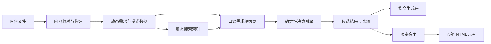

# Architecture Baseline: 说准一点

- 状态：提案 v0.1，待维护者评审；当前代码仍是 buildless HTML/CSS/JavaScript 原型。
- 目标：支持丰富的口语需求目录、多分支的一对多模式推荐、可复用交互示例和精准指令生成，同时保持静态托管。
- 任务引用：Task Constitution T1、T2、T3。

## 上下文与约束

- 范围：公开的中文优先教程网站，交互流程在浏览器端运行；内容以 Git 中的文件为源。
- 主要用户：不知道标准 UI 名词的新手产品经理和 AI Coding 新手。
- 约束：内容增长后仍能贡献和审阅；每条推荐关系可解释；窄屏、键盘和屏幕阅读器可用。
- 隐私：无后端、无账号、无默认遥测；自由文本搜索与分支回答保留在本地。
- 当前基线：`index.html`、`src/app.js`、`src/data/terms.js`、`src/styles.css`；现有页面是按术语浏览的首轮原型。

## 建议边界

| Boundary | Responsibility | Owner | Depends on | Exposes |
|---|---|---|---|---|
| `content/` | 口语入口、问题、分支、模式说明、提示词模板 | 内容维护者 | 内容契约 C-001 | 静态内容集合 |
| `content-schema/` | 校验字段、ID、引用和规则形状 | 工程维护者 | 内容契约 C-001 | 通过构建的类型化内容 |
| `intent-engine/` | 根据选项计算候选模式与理由；在条件不足时继续询问 | 工程维护者 | 通过校验的内容 | 纯函数输入/输出 |
| `site/` | 首页、需求探索、比较、术语索引、详细页面 | 工程维护者 | intent-engine、内容 | 静态 HTML 页面和交互入口 |
| `prompt-builder/` | 从用户答案、模式模板和必要约束生成可编辑指令 | 工程维护者 | 内容契约 C-001 | 文本与可复制动作 |
| `demo-runtime/` | 按 allowlist 装载可操作组件示例并隔离样式/脚本 | 示例维护者 | 示例契约 C-002 | 有标题的预览 iframe |
| `static-build/` | 生成可部署到 GitHub Pages 的静态站点和搜索索引 | 工程维护者 | 上述模块 | `dist/` |

依赖方向：页面读取内容并调用纯决策函数；决策函数不依赖页面或 DOM；内容描述 `demoId`，但不携带可执行脚本；示例运行在隔离的 iframe 中。



## 技术建议

建议迁移到 **Astro + TypeScript，输出纯静态网站**，不引入 React/Vue 服务端、数据库或模型后端。

- Astro 负责基于 Markdown/YAML 内容生成需求页、模式详情页、术语页和站点导航，适合内容密集、需要独立链接和搜索引擎可读的项目。
- TypeScript 约束需求树、条件规则、模式卡和指令字段之间的接口。
- Astro 的轻量客户端脚本承载需求探索、候选比较、搜索、复制和可访问交互；只对真正需要状态的区块发出浏览器 JavaScript。
- Git 中的 Markdown 保存解释性正文；YAML/JSON 保存有结构的关系、问题、选项、判断规则和提示词槽位。
- 构建期检查引用目标、重复 ID、未处理分支、缺少示例、提示词缺字段和循环路径；无需生产数据库。
- GitHub Pages 或兼容静态主机部署；路径应支持仓库子目录。

选择依据：当前 buildless 原型适合七个条目的展示，但内容扩展到数十个口语入口和模式后，纯手写 DOM 容易让内容、路由、决策规则和交互纠缠。Astro 可静态生成可链接的内容页面；无需把整个网站变成客户端应用。

备选方案：

- **继续原生 HTML/JS**：迁移成本最低，但 schema、分支页面、内容引用校验和长篇内容会逐渐变得难维护。可作为当前原型和迁移回退版本。
- **React SPA**：交互状态生态成熟，但本项目无需全站客户端渲染；会让内容页面更依赖组件代码。
- **Astro + React 全量 islands**：保留静态内容优点，但多引入一个 UI 框架；只有出现复杂多步骤交互且原生脚本难以维护时再考虑。

## 组件复用决策

| Component | Capability | Consumers | Decision | Reason |
|---|---|---|---|---|
| Intent Explorer | 按问题答案筛选推荐模式 | 首页、需求详情页 | create | 是产品主流程，现有术语列表没有等价责任 |
| Pattern Comparison | 对照推荐理由、差别和示例 | 需求详情页 | create | 需要把相似模式的判据并列呈现 |
| Prompt Builder | 编辑和复制结构化指令 | 需求详情、模式详情 | create | 多个页面共享一个稳定的数据输入和输出 |
| Demo Frame | 载入隔离的示例页面并提供标题/重置 | 需求详情、模式详情 | create | 多个页面共用生命周期和安全边界 |
| 术语列表样式/品牌 token | 保留现有颜色与视觉线索 | 术语索引、站点 shell | extend | 视觉可延续，主交互信息架构需要重做 |

## 契约

### C-001：口语需求与模式内容

- 状态：提案，首个可用样本审阅后冻结。
- Producer：`content/phrase-groups/` 和 `content/patterns/` 的内容作者。
- Consumers：构建校验器、需求探索器、决策引擎、搜索索引、指令生成器、详情页。
- Inputs：稳定 ID、口语表达/别名、目标、问题和选项、条件规则、模式引用、推荐理由、提示词字段。
- Outputs：校验通过的静态集合；需求答案产生按解释排序的候选模式列表，包含 `patternId` 和 `reason`。
- Compatibility：ID 一经公开即稳定；字段新增可选，删除/改名需更新所有引用和版本；未知模式引用令构建失败。
- Verification：schema 校验和样例分支审阅；每个分支至少有一个可达场景。
- Change rule：新增条件运算符需要同步决策引擎、schema、示例和迁移说明。

核心形状示例：

```ts
type PhraseGroup = {
  id: string;
  phrases: string[];
  userGoal: string;
  questions: Question[];
  recommendations: Recommendation[];
};

type Recommendation = {
  when: Array<{ questionId: string; optionId: string }>;
  primaryPatternId: string;
  supportingPatternIds: string[];
  reason: string;
  alternativePatternIds: string[];
};

type Pattern = {
  id: string;
  term: string;
  aliases: string[];
  definition: string;
  useWhen: string[];
  avoidWhen: string[];
  demoId: string;
  promptTemplate: string;
};
```

一个需求族引用多个推荐结果；每个结果可以由一个主要模式和零个或多个辅助模式组成。Pattern ID 在内容、搜索、示例注册和指令生成间共享。

### C-002：示例注册与隔离

- 状态：提案。
- Producer：示例维护者提供 allowlisted `demoId` 和静态示例文件。
- Consumers：预览宿主和模式详情。
- Inputs：已知 demo ID、模式参数、可读标题；内容不得指定任意脚本或远程 URL。
- Outputs：带有描述标题的沙箱 iframe；示例可在本框架内完成交互。
- Compatibility：所有模式通过注册表选择 demo；缺失 ID 在构建期失败。
- Verification：手动交互检查、键盘检查和窄屏检查；需要时检查 iframe sandbox 属性。
- Change rule：跨 frame 通信先经过独立评审；初期避免该通信。

## 安全、隐私与无障碍

- Markdown/YAML 内容当作不可信数据：渲染时转义文本，不允许通过内容字段注入 HTML 或脚本。
- 示例按 `demoId` 白名单加载到 `sandbox="allow-scripts"` iframe，不给同源访问和顶层导航权限；默认不接收 frame 消息。
- 搜索、分支答案、指令生成均在浏览器本地运行，不发送用户文本。
- 每个预览有易理解的 iframe 标题；按钮、字段和错误状态有可访问名称；键盘可以到达并操作所有控件。
- 显式显示 tooltip、toast、modal 和 drawer 的键盘与焦点行为；尊重 `prefers-reduced-motion`。

## 迁移、回退和待决项

1. 保留当前七项内容和品牌 CSS，先将七项映射到新 `Pattern` 模型，再做首页需求入口。
2. 在一个新分支实现内容 schema 和一组示例数据；只有 schema 和一次端到端需求路径稳定后再替换 `index.html`。
3. Astro 版本发布前保留上一版静态源码和 Git 提交；如果静态构建/路径/互动失败，回退到旧部署或恢复上一提交。
4. 无持久化用户数据，无需数据库迁移；更换静态构建工具只需重新生成 `dist/`。

待维护者确认：Astro 技术选型、首期内容数量与范围、是否现在开始从 buildless 原型迁移。开源许可证仍按 Task Constitution T3 单独决定。
