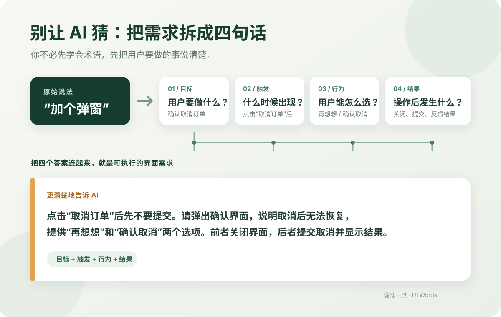

# 你以为自己在和 AI 沟通，其实是在让它猜谜

> 写给每一个想用 AI 做产品、做网页，却总觉得“它怎么又没听懂”的人。

“帮我做一个好看的页面。”

“这里加个弹窗。”

“这个按钮优化一下，做得高级一点。”

这些话，我们都说过。然后 AI 很快交出一版看起来像那么回事的界面。你点进去，却发现弹窗出现的时机不对、按钮点完没反馈、列表里的“选择框”根本不是你想要的那个。

你只好继续补充：“不是这个意思。再改一下。这里也不对……”

几轮下来，页面越来越复杂，要求越来越长，你甚至开始怀疑：是不是我不会提问？是不是我得先学会一堆英文术语，AI 才肯听懂？

**问题常常不在于你不会表达，而在于一句日常说法，给 AI 留下了太多种解释。**

## 你说了“弹窗”，AI 却不知道你要哪一种

“弹窗”听起来像一个明确的需求，其实可能指完全不同的事：

- 操作成功后，轻轻提示一下就消失；
- 删除重要内容前，停下来让用户确认；
- 不离开当前列表，从旁边拉出一块详情；
- 点头像或按钮后，在旁边出现一小块选项。

它们看起来都可能是“弹出来的东西”，但对用户的影响差别很大。有的会打断操作，有的不会；有的需要用户做决定，有的只是告诉用户结果。

当你只说“加个弹窗”，AI 只能替你补全这些没说出口的条件。它补得越多，猜错的机会也越多。你看到的“AI 不听话”，有时其实是你们还没有对齐：用户到底要完成什么，界面应该怎样回应。

## 小白用 AI，最容易卡在这几步

### 1. 说的是界面名字，真正想要的是用户结果

“做个下拉框”只描述了外观。你真正想解决的也许是：让用户从 5 个固定选项里挑一个，也许是让他从几千个客户里搜索，也许是允许同时选多个标签。

这些目标不同，合适的交互也可能不同。只给 AI 一个界面名字，它很难知道你脑子里的那一个。

### 2. 第一版不对，却不知道该补充哪句话

很多人只能说：“不太对”“看起来怪怪的”“再像大厂一点”。这些感受是真实的，但 AI 很难据此判断究竟要改布局、操作方式、反馈，还是信息层级。

### 3. 越改越多，前面说过的话开始互相打架

“弹窗不要挡住页面”，下一轮又说“必须先确认才能继续”；“选项要少一点”，后面又加上搜索和多选。需求本身在变化，AI 却不一定知道哪些是新决定、哪些是旧要求。

于是你开始补丁式地改提示词，改一处、坏一处。最后一大段对话堆在那里，双方还是没对上。

### 4. 以为要先背术语，才有资格把需求说清楚

新手常常被 `Dialog`、`Popover`、`Combobox` 这些词吓住。但你不需要先成为交互设计专家，才能把想法告诉 AI。

**术语是用来帮助我们区分做法的，不是让新手先通过考试的。**先说明用户要做什么，很多选择就能慢慢变清楚。

## 把“给我一个弹窗”换成四个答案

下次让 AI 做界面时，先试着补上这四件事：

1. **目标：**用户要完成什么？
2. **触发：**在什么操作之后出现？
3. **行为：**用户能做什么选择？能不能继续操作背景页面？
4. **结果：**点完之后，界面怎样结束或反馈？

比如，不要只说：

> 给取消订单加个弹窗。

可以改成：

> 用户点击“取消订单”后先不要提交。请显示一个确认界面，说明取消后无法恢复；提供“再想想”和“确认取消”两个选项。点击“再想想”就关闭界面，点击“确认取消”后再提交，并告诉用户处理结果。

这段话没有用多少专业术语，却已经讲清了用户的目标、触发时机、可选操作和结束结果。AI 少猜几步，做出来的界面就更接近你真正想要的东西。

## 所以我们做了「说准一点」

我们做这个项目，就是想帮第一次做产品、第一次用 AI 写界面的人，跨过“我知道我想要什么，但不知道怎么说”的那一步。

「说准一点 · UI Words」不是让你背一份术语表。你可以从自己熟悉的话开始，比如“加个弹窗”“做个选择框”“提示一下”；也可以从用户要完成的事开始。系统会用具体问题帮你分辨：你要的是确认、通知、搜索、选择，还是查看详情？

然后，你可以对照不同做法的效果，直接操作页面里的小例子，看它们到底哪里不一样。选定方向后，再把更具体的中文说明带给 AI。

我们希望解决的不是“用户不会说英文术语”，而是：**不懂交互设计，也能把自己想做的界面讲明白。**

它不能替你决定产品应该是什么样，也不能保证 AI 每次一次写对。但它可以先帮你把含糊的地方摊开，让你在让 AI 动手之前，先看见自己真正需要选什么。

## 下次别急着说“再改一下”

当 AI 做出来的东西不对，先别急着怪自己不会提问，也别只丢一句“高级一点”。退一步问问：

- 用户点这个东西，是想完成什么？
- 他什么时候需要看到这个界面？
- 他需要选择、确认，还是只要知道结果？
- 操作结束后，页面应该怎样回应？

把这些问题想清楚，不是为了写出更长的提示词，而是为了少一点猜测、少几轮返工，让你和 AI 真正说到一块儿。

如果你也在用 AI 做产品、做网页，欢迎来试试「说准一点」。

https://github.com/jinhefeng/ui-words-for-ai
